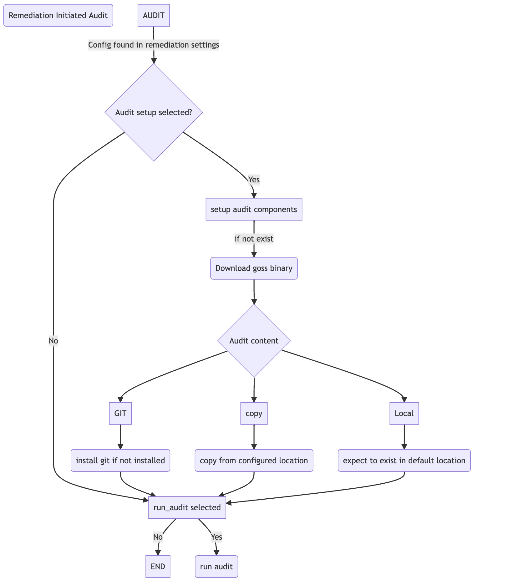

Using Audit and Remediate together
==================================

Using both Audit and Remediate in a workflow

Post Hardening Lockdown Reporting via Ansible_Facts
===================================================

The ``templates/etc/ansible/compliance_facts.j2`` template records metadata and conditions related to the hardening performed by the **Ansible Lockdown** role.

**Lockdown Ansible_Facts: Creating Custom Compliance Facts**

The playbook conditionally creates a custom facts file on managed hosts to document the applied security benchmark and hardening levels.
The excerpt below is from ``RHEL10-CIS/tasks/main.yml``; other roles follow the same pattern with small differences (for example the file mode).

.. code-block:: yaml

    - name: Add ansible file showing Benchmark and levels applied if audit details not present
      when:
        - create_benchmark_facts
        - (post_audit_results is defined) or
          (ansible_local['compliance_facts']['lockdown_audit_details']['audit_summary'] is undefined and post_audit_results is undefined)
      tags:
        - always
        - benchmark
      block:
        - name: Create ansible facts directory if audit facts not present
          ansible.builtin.file:
            path: "{{ ansible_facts_path }}"
            state: directory
            owner: root
            group: root
            mode: 'u=rwx,go=rx'

        - name: Create ansible facts file and levels applied if audit facts not present
          ansible.builtin.template:
            src: etc/ansible/compliance_facts.j2
            dest: "{{ ansible_facts_path }}/compliance_facts.fact"
            owner: root
            group: root
            mode: 'u-x,go=r'

**Key Components**

- **Conditional Execution**: The block runs only if ``create_benchmark_facts`` is ``true`` (the default), and either a post-remediation audit has produced results or no audit summary has been recorded yet.

- **Tagging**: The tasks are tagged with ``always`` and ``benchmark``, allowing for selective execution during playbook runs.

- **Directory Creation**: Ensures the existence of the directory specified by ``ansible_facts_path`` (default ``/etc/ansible/facts.d``), setting appropriate permissions.

- **Facts File Creation**: Uses a Jinja2 template to generate the ``compliance_facts.fact`` file in the specified directory.

**Custom Facts in Role**

Ansible allows the use of custom facts to store host-specific information. These facts are typically stored in files within the ``/etc/ansible/facts.d``
directory on the managed hosts. The facts files can be in JSON or INI format and are loaded automatically during the fact-gathering phase.
The facts are named after the file, so ``compliance_facts.fact`` appears as ``ansible_local.compliance_facts``. Ansible reads INI keys in lowercase.

**Accessing Custom Facts**

Once the custom facts are in place and facts have been gathered, they can be accessed in playbooks using the ``ansible_local`` variable.

.. code-block:: jinja

    {{ ansible_local.compliance_facts.lockdown_details.benchmark_release }}

Lockdown Facts Example:
-----------------------

**Variables Used**

- ``benchmark`` and ``benchmark_version``: The role and benchmark version being applied.
- **CIS** ``<role>_level_1 | <role>_level_2``: Booleans that indicate if level 1 or 2 hardening is enabled.
- **STIG** ``<role>_cat1 | <role>_cat2 | <role>_cat3``: Indicate whether Category I, II, or III controls were enabled during the hardening process.
- ``ansible_run_tags``: List of tags used during the playbook run to identify scope
- ``run_audit``: Boolean to indicate if an audit was performed.
- ``audit_log_dir``: Path to local audit log directory on the node.
- ``post_audit_results``: Captured summary results from post-audit steps.
- ``fetch_audit_output``: Boolean flag to indicate whether audit logs were centralized.
- ``audit_output_destination``: Destination directory for centralized audit files.

The template snippets below are from RHEL10-CIS and RHEL10-STIG. Other roles differ slightly: for example some CIS roles
write ``Benchmark_release = CIS-{{ benchmark_version }}`` with no separate version line, and some roles (for example UBUNTU24-STIG)
do not write the ``[lockdown_audit_details]`` section.

CIS
+++

1. **Template** (RHEL10-CIS)

   ``[lockdown_details]`` holds the benchmark used, the run date and the hardening levels enabled.
   ``[lockdown_audit_details]`` captures audit information when auditing is enabled.

.. code-block:: jinja

  [lockdown_details]
  # Benchmark release
  Benchmark_release = {{ benchmark }}
  Benchmark_version = {{ benchmark_version }}
  Benchmark_run_date = {{ '%Y-%m-%d - %H:%M:%S' | ansible.builtin.strftime }}
  # If options set (doesn't mean it ran all controls)
  level_1_hardening_enabled = {{ rhel10cis_level_1 }}
  level_2_hardening_enabled = {{ rhel10cis_level_2 }}

  
  # If tags used to stipulate run level
  
  Level_1_Server_tag_run = true
  
  
  Level_2_Server_tag_run = true
  
  
  Level_1_workstation_tag_run = true
  
  
  Level_2_workstation_tag_run = true
  
  

  [lockdown_audit_details]
  
  # Audit run
  audit_run_date = {{ '%Y-%m-%d - %H:%M:%S' | ansible.builtin.strftime }}
  audit_file_local_location = {{ audit_log_dir }}
  
  audit_summary = {{ post_audit_results }}
  
  
  audit_files_centralized_location = {{ audit_output_destination }}
  
  

2. **Example output**

.. code-block:: console

      ansible hosts -i ../inv -m setup -a "filter=ansible_local"
      hosts | SUCCESS => {
         "ansible_facts": {
            "ansible_local": {
               "compliance_facts": {
                  "lockdown_audit_details": {
                     "audit_file_local_location": "/opt",
                     "audit_run_date": "2026-10-30 - 14:59:43",
                     "audit_summary": "Count: 798, Failed: 24, Skipped: 6, Duration: 38.824s"
                  },
                  "lockdown_details": {
                     "benchmark_release": "RHEL10-CIS",
                     "benchmark_run_date": "2026-10-30 - 14:59:43",
                     "benchmark_version": "v1.0.1",
                     "level_1_hardening_enabled": "True",
                     "level_2_hardening_enabled": "True"
                  }
               }
            },
            "discovered_interpreter_python": "/usr/bin/python3"
         },
         "changed": false
      }

STIG
++++

1. **Template** (RHEL10-STIG)

   ``[lockdown_details]`` holds the benchmark used, the run date and the categories enabled.
   ``[lockdown_audit_details]`` captures audit information when auditing is enabled.

.. code-block:: jinja

  [lockdown_details]
  # Benchmark release
  Benchmark_release = STIG-{{ benchmark_version }}
  Benchmark_run_date = {{ '%Y-%m-%d - %H:%M:%S' | ansible.builtin.strftime }}
  # If options set (doesn't mean it ran all controls)
  cat_1_hardening_enabled = {{ rhel10stig_cat1 }}
  cat_2_hardening_enabled = {{ rhel10stig_cat2 }}
  cat_3_hardening_enabled = {{ rhel10stig_cat3 }}

  
  # If tags used to stipulate run level
  
  Cat_1_Server_tag_run = true
  
  
  Cat_2_Server_tag_run = true
  
  
  Cat_3_Server_tag_run = true
  
  

  [lockdown_audit_details]
  
  # Audit run
  audit_run_date = {{ '%Y-%m-%d - %H:%M:%S' | ansible.builtin.strftime }}
  audit_file_local_location = {{ audit_log_dir }}
  
  audit_summary = {{ post_audit_results }}
  
  
  audit_files_centralized_location = {{ audit_output_destination }}
  
  

2. **Example output**

.. code-block:: console

      ansible hosts -i ../inv -m setup -a "filter=ansible_local"
      hosts | SUCCESS => {
         "ansible_facts": {
            "ansible_local": {
               "compliance_facts": {
                  "lockdown_audit_details": {
                     "audit_file_local_location": "/opt",
                     "audit_run_date": "2026-10-30 - 14:59:43",
                     "audit_summary": "Count: 979, Failed: 73, Skipped: 22, Duration: 18.411s"
                  },
                  "lockdown_details": {
                     "benchmark_release": "STIG-v1.2.0",
                     "benchmark_run_date": "2026-10-30 - 14:59:43",
                     "cat_1_hardening_enabled": "True",
                     "cat_2_hardening_enabled": "True",
                     "cat_3_hardening_enabled": "True"
                  }
               }
            },
            "discovered_interpreter_python": "/usr/bin/python3"
         },
         "changed": false
      }
