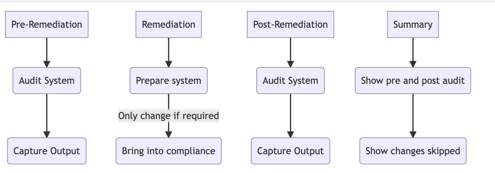

Automated Security Benchmark - Auditing and Remediation
=======================================================

.. image:: https://img.shields.io/github/stars/ansible-lockdown?label=Org%20Stars&style=social
  :target: https://github.com/ansible-lockdown

.. image:: https://img.shields.io/github/followers/ansible-lockdown?style=social
  :target: https://github.com/ansible-lockdown

.. image:: https://img.shields.io/discord/925818806838919229?logo=discord
  :target: https://www.lockdownenterprise.com/discord

MindPoint Group - A Quantum Sky Company's (QuantumSky_) Ansible-Lockdown Overview
---------------------------------------------------------------------------------
This documentation explains the purpose of the Ansible Lockdown automated security benchmarks and how
to use them to audit and remediate system security. The Ansible_ roles can be applied to systems to
improve security posture, meet compliance requirements, and deploy without disruption after due diligence.
Security hardening is based on the industry-recognized CIS_ benchmarks and DISA_ STIG_ guides, implemented
as open-source licensed configurations that bring systems into security compliance. The content consists of
an audit component that scans a host for compliance with Syver_, a fork of GOSS_ (the Windows STIG roles use
the SCAP Compliance Checker instead), and a remediate component that can be run centrally from an
**Ansible control node** to bring hosts into compliance. Development and releases run through the
Ansible Lockdown GitHub_ devel and main branches, with ansible-galaxy_ updates aligned to new benchmark
versions.

Why should this role be applied to a system?
--------------------------------------------

There are **three** main reasons to apply this role to systems:

- **1. Improve security posture**

    The configurations from the adopted benchmark add security and rigor around multiple
    components of an operating system, including user authentication, service
    configurations, and package management. All of these configurations add up
    to an environment that is more difficult for an attacker to penetrate and use
    for lateral movement.

- **2. Meet compliance requirements**

    Some deployers may be subject to industry compliance programs, such as
    PCI-DSS, HIPAA, ISO 27001/27002, or NIST 800-53. Many of these programs require
    hardening standards to be applied to systems.

- **3. Deployment without disruption**

    Security is often at odds with usability. The role provides the greatest
    security benefit without disrupting production systems. Deployers have the
    option to opt out or opt in for most configurations depending on how their
    environments are configured.

What is security hardening?
---------------------------
Based upon industry recognized benchmarks and best practices,
using leading products to enable highly adjustable configurations
to bring your systems/platforms into security compliance.

- Open-Source (MIT licensed)

  - Community supported as standard
  - Enterprise support available

- Configuration-as-code

  - Assist in bringing your systems/platform into compliance through the use of Ansible_
  - Audit your current system/platform using Syver_, a fork of GOSS_ (SCAP Compliance Checker on the Windows STIG roles)

- Highly configurable to work with your systems

The content delivered is based upon either one of the two major contributors to the security best practices in the IT industry.

- **Center for Internet Security** (CIS_):

  - A global IT community of experts helping to build, document sets of benchmarks to produce industry best security practices.
  - CIS Benchmarks are vendor agnostic, consensus-based security configuration guides both developed and accepted by government, business, industry, and academia.

**or**

- **Security Technical Implementation Guide** (STIG_):

  - From the Defense Information Systems Agency (DISA_)
  - The STIG is released with a public domain license and it is commonly used to secure systems at public and private organizations around the world.

.. note::
  Both CIS_ and STIG_ are well-known and respected benchmarks created for the industry to assist in achieving recognized compliance (e.g. PCI DSS, HIPAA, SOC2, NIST) and adopting security best practices.

.. toctree::
   :maxdepth: 2
   :caption: Benchmark Overview

   CIS/cis_overview.rst
   STIG/stig_overview.rst

What is provided?
-----------------

The content provided is open-source licensed configurations to assist in
achieving or auditing compliance to one of the benchmark providers listed above.

This consists of two components:

- **Audit**

  - Runs a small single Go binary on the system: Syver_, a fork of GOSS_ (some roles still pin its earlier
    release, krameff/goss).
  - The Windows STIG roles scan with the SCAP Compliance Checker (SCC) instead, NIWC Atlantic's scanner for
    DISA's STIG content.
  - Enables you to very quickly scan your host and output the status of compliance for your host.

- **Remediate**

  - Has the ability to run from a central location using the configuration management tool ansible.
  - Can assist with bringing your host into compliance for the relevant benchmark.

Both can be run alone or in conjunction with each other.

How is this written?
--------------------

We analyze each configuration control from the applicable benchmark to determine what impact it has on a live production environment and how to
best implement a way to audit the current configuration and how to achieve those requirements using Ansible.
Tasks are added to the role that configure a host to meet the configuration requirements. Each task is documented to explain what was changed,
why it was changed, and what deployers need to understand about the change.

Deployers have the option to enable or disable every control that does not suit their environment's needs.
Every control item has an associated variable that can be used to switch it on or off.

Additionally, the items that have configurable values, e.g. number of password attempts, will generally have a corresponding variable that allows for
customization of the applied value.
It is imperative for each deployer to understand the regulations and compliance requirements that their organization and specific
environments are responsible for meeting in order to effectively implement the controls in the relevant benchmark.

Baselines are typically designed for the x86_64 architecture. But, with the growing popularity of ARM64/aarch64 systems
(AWS Graviton, Azure Ampere, Google Tau T2A), we have extended our support for hardening on ARM as well.
This rollout brings certain challenges, particularly regarding the audit component and auditd syscall differences,
and it is not officially covered by the baseline provider. However, we strive to provide support for ARM as part of our pipelines.

For detailed ARM64 guidance, see :doc:`ARM64/aarch64 Architecture Guide <arm64-guide>`.

Development Process
-------------------

Lifecycle of releases and branches
^^^^^^^^^^^^^^^^^^^^^^^^^^^^^^^^^^

Remediate and Audit are managed separately, but some of their content is linked.
Sometimes both need updating, and sometimes only one of them does.

As a rule, our goal is to follow the lifecycle process below for branches and releases, including ansible-galaxy_ sync updates.
Direct customer requests and requirements can take priority in releases.
For more detail, see :doc:`combined/release_sched`.

Branches
^^^^^^^^

Remediate
~~~~~~~~~

- **devel branch**

   - Staging area for bug fixes, PRs and new benchmarks.
   - Default and working development branch.
   - We aim to merge the majority of PRs to devel within 2-4 weeks.
   - Community Collaboration PR (Pull Request) Branch.

- **main branch** *(The release branch)*

   - We merge from devel to main branch.
   - The timing of a merge to main depends on the severity and impact of the issues closed.
   - Routinely, a release alignment is every 8-12 weeks (sometimes much quicker).
   - Once a new CIS_/STIG_ benchmark gets released, we aim to merge the new tagged release (2-4 weeks).
   - The major releases are sourced and linked to ansible-galaxy_ Roles.

Audit
~~~~~

- **benchmark_version**

Audit content is specific to each benchmark release, so audit branches are named after the benchmark version they test.
This allows the playbook to test for the correct settings for that version.

- For example, RHEL9-CIS-Audit has the branches benchmark_v1.0.0, benchmark_v2.0.0 and benchmark_v3.0.0.

Demos
^^^^^

.. image:: https://img.youtube.com/vi/sbIfaNsoszM/maxresdefault.jpg
    :alt: Ansible Lockdown - RHEL 9 CIS Baseline Demo
    :target: https://www.youtube.com/watch?v=sbIfaNsoszM

.. image:: https://img.youtube.com/vi/5OdT3k2IDVo/maxresdefault.jpg
    :alt: Ansible Lockdown - M. Bolwell Audit and Compliance Benchmarks Demo/Q and A
    :target: https://www.youtube.com/watch?v=5OdT3k2IDVo

.. _Ansible: https://www.redhat.com/en/ansible-collaborative
.. _GOSS: https://github.com/goss-org/goss
.. _Syver: https://github.com/krameff/syver
.. _STIG: https://www.cyber.mil/stigs/downloads/
.. _CIS: https://www.cisecurity.org/cis-benchmarks/
.. _ansible-galaxy: https://galaxy.ansible.com/ui/standalone/namespaces/4668/
.. _DISA: https://www.disa.mil/
.. _GitHub: https://github.com/ansible-lockdown
.. _QuantumSky: https://www.quantumsky.com
